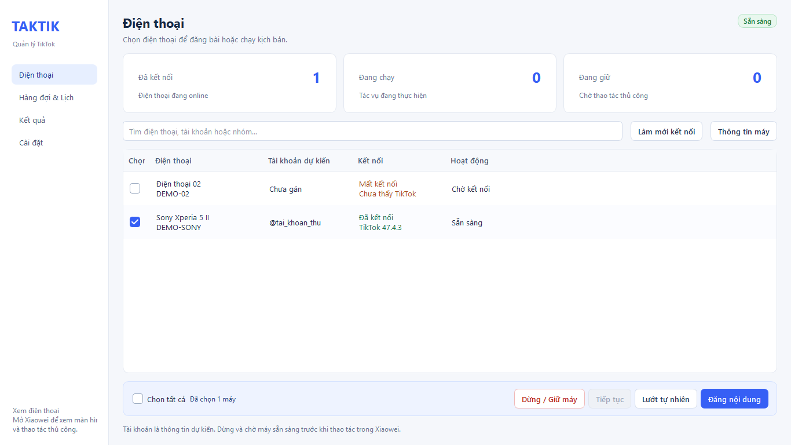
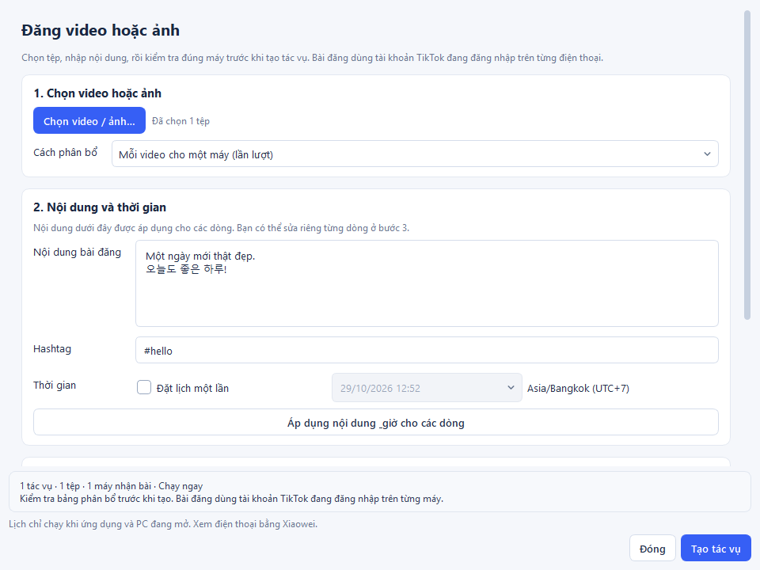
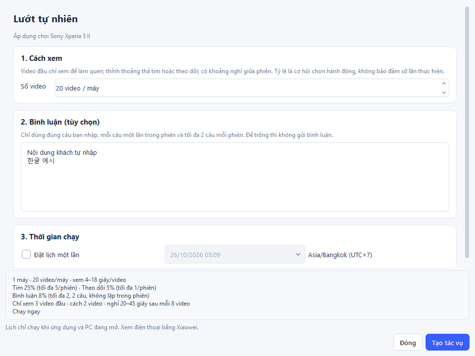
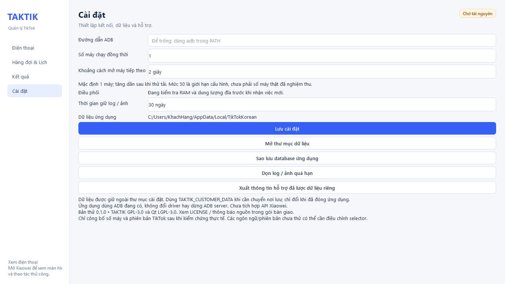

# TAKTIK — Giao diện tiếng Việt cho Windows

Ứng dụng thử nghiệm 0.1.0, Python + PySide6 Qt Widgets, dùng engine TAKTIK public.
Xiaowei vẫn dùng để xem màn hình và thao tác thủ công; ứng dụng không stream màn hình.

## Chạy từ mã nguồn

Trong thư mục repository, mở PowerShell:

```powershell
python -m venv .venv
.\.venv\Scripts\python -m pip install -r requirements-desktop.txt
.\.venv\Scripts\python -m customer_desktop
```

Chạy bản đóng gói: mở `dist/customer-desktop/TikTokKorean/TikTokKorean.exe`.
Giữ nguyên thư mục `engine`, `_internal`, `licenses` và thông báo nguồn bên cạnh EXE.
Khách không cần cài Python để chạy bản đóng gói. ADB phải có sẵn trong PATH hoặc được chọn trong Cài đặt.


## Giao diện dành cho khách

Lần mở đầu tiên cần **kích hoạt bản quyền**. Bấm **Sao chép mã máy**, gửi mã cho người cấp license rồi dán key được cấp. Key chỉ dùng trên máy tính Windows tương ứng, có hiệu lực từ lúc cấp đến ngày hết hạn hiển thị. Không cần nhập tài khoản TikTok để kích hoạt. Có thể xem mã máy/ngày hết hạn và gia hạn trong **Cài đặt → Kích hoạt / Gia hạn license**. Cài lại Windows có thể thay mã máy và cần cấp lại key.

App kiểm tra license khi mở, nhận việc và bắt đầu tác vụ. Hết hạn trong lúc chạy sẽ yêu cầu dừng tác vụ và chặn việc tiếp theo, giữ nguyên hàng đợi/dữ liệu. Đồng bộ đúng ngày giờ Windows nếu app báo đồng hồ bị lùi. License hoạt động offline, không có chức năng thu hồi từ xa.

- **Điện thoại**: chọn máy, xem trạng thái, đăng nội dung hoặc lướt tự nhiên. Thanh dưới bảng cho biết chính xác số máy đã chọn; bỏ đánh dấu là bỏ chọn. Có thể chọn tất cả các máy đang hiện trong bộ lọc.
- **Hàng đợi & Lịch**: xem việc đang chạy, mục đang chờ và lịch hẹn. Nút sửa/hủy/dừng chỉ bật khi phù hợp với trạng thái mục đã chọn.
- **Kết quả**: xem kết quả và bằng chứng. Mục **Cần kiểm tra** vẫn được giữ để đối chiếu, không tự gửi lại.
- **Cài đặt**: kết nối ADB, lưu dữ liệu, sao lưu và hỗ trợ.

Form chia thành các nhóm bước; phần tóm tắt và nút **Tạo tác vụ** luôn ở dưới. Nút này chỉ bật khi dữ liệu cần thiết đã hợp lệ. Dùng thanh cuộn để xem các mục bên dưới khi màn hình nhỏ hoặc chữ Windows được phóng lớn.

## Kết nối và quản lý máy

1. Bật USB debugging, cắm cáp và chấp nhận quyền ADB trên điện thoại.
2. Bấm **Làm mới kết nối**. Máy unauthorized: chấp nhận quyền rồi làm mới; offline: kiểm tra cáp.
3. Với điện thoại mới, chọn một hoặc nhiều máy (có thể bấm **Chọn tất cả**) rồi bấm **Cài ADBKeyboard**. Tool dùng APK đi kèm, cài và bật bàn phím rồi kiểm tra lại. Máy đã có bàn phím tương thích sẽ được dùng lại; bàn phím mặc định chỉ được chuyển khi tác vụ cần nhập chữ. Nếu Android yêu cầu, mở khóa và chấp nhận cài trên điện thoại. Tool cài lần lượt, bỏ qua máy mất kết nối hoặc đang bận, và tiếp tục các máy còn lại khi một máy lỗi. Bảng kết quả hiển thị riêng từng máy. Chờ kết quả thành công trước khi chạy.
4. Chọn máy, bấm **Thông tin máy**. Cột Tài khoản dự kiến tự cập nhật @username khi engine đọc hồ sơ tài khoản đang đăng nhập và được lưu theo từng điện thoại. Lần mở sau khôi phục thông tin đã đọc nếu ô còn trống. Có thể sửa nhãn thủ công; lần đọc hồ sơ thành công tiếp theo sẽ cập nhật lại tài khoản thực tế. Đây không phải thao tác chuyển tài khoản trên điện thoại.
5. Khi đăng, ứng dụng dùng tài khoản TikTok đang đăng nhập trên máy; không cần nhập tên tài khoản hoặc xác nhận trong Xiaowei.

Để bỏ điện thoại cũ khỏi bảng, chọn máy **Mất kết nối** → **Xóa khỏi danh sách** rồi xác nhận.
Máy còn tác vụ chờ, lịch chạy, phiên chưa thu dọn hoặc đang cài bàn phím cần được xử lý xong trước.
Lịch sử tác vụ và nhật ký vẫn được giữ. Máy đã xóa không hiện lại khi làm mới/mở lại app;
khi kết nối ADB trở lại, máy sẽ tự xuất hiện cùng tên và nhãn đã lưu.

Để nhập caption/comment, điện thoại cần Taktik Keyboard (`com.alexal1.adbkeyboard`) hoặc
ADB Keyboard tương thích (`com.android.adbkeyboard`) đã cài từ nguồn được kiểm chứng.
Ứng dụng phát hiện bàn phím có sẵn, không tự tải/cài APK. Sau mỗi phiên, bàn phím ban đầu
được khôi phục trước khi mở khóa hàng đợi. Nếu mất USB, có thể cần chọn lại bàn phím thủ công.
Đóng thông báo nổi che TikTok trước khi chạy. Bản client chặn các phase đăng khi phát hiện thông báo nổi.

### Lỗi khi chạy trên máy khách

- **Access is denied / license-clock.bin**: đóng app và các tác vụ, chuyển toàn bộ thư mục
  ứng dụng (giữ nguyên `data`) sang thư mục có quyền ghi ngoài OneDrive, ví dụ
  `D:\TikTokKorean`, rồi mở lại. Không xóa file license hoặc file kiểm tra đồng hồ.
  Bản cập nhật có khóa ghi giữa các engine và thử lại khi Windows tạm khóa file;
  nếu vẫn lỗi, kiểm tra quyền ghi và phần mềm bảo vệ trên máy khách.
- **Thiếu bàn phím Taktik/ADB tương thích**: bàn phím cần cài trên từng điện thoại,
  không phải trên PC. Kiểm tra bằng ADB đang được chọn trong Cài đặt:
  `adb -s SERIAL shell ime list -s -a` (thay SERIAL bằng mã điện thoại).
  App hiện nhận `com.alexal1.adbkeyboard/.AdbIME` hoặc
  `com.android.adbkeyboard/.AdbIME`. Nếu chưa có, cài APK đã được kiểm chứng rồi thử lại.
  Để thử lướt không nhập chữ, đặt tỷ lệ bình luận bằng 0; caption/hashtag khi đăng
  vẫn cần bàn phím. Nếu bàn phím đã cài mà vẫn bị báo thiếu, gửi kết quả lệnh trên
  để đối chiếu đúng mã IME, không cài thêm APK không rõ nguồn.



## Đăng video hoặc ảnh

Chọn **Ứng dụng → TikTok Lite / TikTok thường** ngay trong màn hình Đăng nội dung.
Nếu muốn dùng khác nhau trên các máy, chọn **Chọn riêng từng máy** rồi chọn ứng dụng cho từng máy.
Lựa chọn được chốt cho tác vụ mới; đổi ứng dụng không làm mất nội dung hoặc giờ đã sửa trong bảng.

1. Chọn máy bằng ô đánh dấu hoặc bấm vào dòng máy, bấm **Đăng nội dung**, chọn video/ảnh trên PC.
2. Chọn rõ “Mỗi video cho một máy” hoặc “Mỗi video cho tất cả máy”. Xem mỗi dòng phân bổ trước khi tạo.
3. Nhập caption, hashtag; sửa riêng theo từng dòng khi cần. Hỗ trợ Unicode, xuống dòng và Hangul trong snapshot.
4. Kiểm tra bảng phân bổ ở bước 3. Đây là nội dung sẽ được đăng thật. Mỗi bài dùng tài khoản TikTok đang đăng nhập trên máy đó; không có ô nhập tài khoản và không cần xác nhận tài khoản trong Xiaowei.
5. Chọn chạy ngay hoặc đặt lịch; bấm **Tạo tác vụ**. Nút này bật khi đã có ít nhất một dòng phân bổ và không có lần gửi nào đang chờ.

Ứng dụng sao chép file vào thư viện, lưu SHA-256 và kiểm tra lại trước khi chạy.
Không xóa bản gốc. File đã thay đổi hoặc bị mất bị chặn trước khi mở worker.
Engine chọn media mới nhất trong gallery, vì vậy không thêm/chụp file khác trên máy trong lúc chạy.



## Lướt tự nhiên và kịch bản đã lưu

Chọn **Ứng dụng → TikTok Lite / TikTok thường** ngay đầu màn hình Lướt tự nhiên.
Có thể **Chọn riêng từng máy** khi chạy một nhóm dùng cả hai ứng dụng.
Bấm **Lưu kịch bản** để lưu cả lựa chọn ứng dụng cùng các thông số lướt; giờ hẹn và danh sách máy chạy không được tự chọn lại.
Các tác vụ đã tạo giữ nguyên ứng dụng; mục **Thông tin máy** chỉ dùng cho thông tin điện thoại.

Chọn điện thoại → **Lướt tự nhiên** → nhập số video → tùy chọn nhập bình luận → mở **Cài đặt nâng cao** để chỉnh thời gian xem, tỷ lệ/giới hạn tương tác, video đầu chỉ xem, khoảng cách tương tác và khoảng nghỉ.

Để chạy theo phút, bật **Chạy theo thời gian**, nhập **Thời gian chạy** (1–1.440 phút/máy). Khi bật, số video không dùng để kết thúc phiên. Thời gian tính từ khi engine bắt đầu phiên lướt, gồm điều hướng, xem video, tương tác và nghỉ; thời gian chờ hàng đợi/kết nối ban đầu không tính. Hết giờ sẽ kết thúc sau thao tác đang thực hiện và ghi **Đã chạy đủ thời gian lướt đã cài đặt**. Nếu gặp lỗi hoặc bạn bấm dừng trước đó, kết quả vẫn cần kiểm tra như bình thường. Bấm **Lưu kịch bản** để ghi nhớ chế độ và số phút cho những lần sau.

**Các máy đã chọn tự chạy song song khi chạy theo thời gian**, tối đa 50 máy đang hoạt động trên PC. Ví dụ chọn 50 máy và đặt 30 phút: app khởi động các phiên trong cùng đợt, mỗi máy lướt 30 phút từ lúc phiên của máy đó bắt đầu; không cần chỉnh số máy đồng thời hoặc khoảng cách khởi động trong Cài đặt. Các máy có thể bắt đầu lệch nhau do kết nối. Máy đang bận sẽ chờ phiên trước kết thúc; máy đang giữ/dừng, mất kết nối hoặc cần kiểm tra phải được xử lý trước. App vẫn chờ khi RAM/đĩa không đủ. Chọn hơn 50 máy thì các máy còn lại chờ có chỗ trống.

Bấm **Lưu kịch bản** một lần để lưu số video, danh sách bình luận và toàn bộ cài đặt nâng cao trên máy tính này. Lần sau mở form (kể cả sau khi đóng/mở app), cấu hình tự điền lại. Giờ hẹn và điện thoại được chọn không được lưu trong kịch bản. Sau đó chọn chạy ngay hoặc đặt lịch → **Tạo tác vụ**.

Tỷ lệ 0% tắt hành động; nếu bật thì giới hạn mỗi phiên phải lớn hơn 0. Thời gian tối thiểu không được vượt tối đa; lỗi hiển thị ở phần tóm tắt và chặn lưu/tạo. Để trống bình luận sẽ không gửi, nhưng tỷ lệ/giới hạn bình luận đã lưu vẫn được giữ cho khi nhập thêm câu. Mỗi câu chỉ được dùng một lần trong phiên, nên giới hạn thực tế không vượt số câu duy nhất.

**Khôi phục mặc định** chỉ điền lại form; bấm **Lưu kịch bản** để ghi nhớ mặc định cho lần sau. Đóng form không tự lưu các chỉnh sửa chưa lưu. Cấu hình đã lưu áp dụng chung cho các điện thoại được chọn khi tạo tác vụ mới.
Không cần chọn mẫu, bật/tắt từng hành động hoặc chỉnh xác suất. Mặc định xem 20 video mỗi máy rồi kết thúc phiên.

Cấu hình mặc định khi chưa tùy chỉnh:

- Xem mỗi video khoảng 4–18 giây theo nội dung và nhịp phiên; 3 video đầu chỉ xem.
- Thỉnh thoảng thả tim hoặc theo dõi; mỗi video tối đa một hành động và giữa hai lần thử có ít nhất 2 video chỉ xem.
- Nghỉ 20–45 giây sau mỗi 8 video. Đạt giới hạn tương tác vẫn xem tiếp đến đủ số video đã đặt.
- Tim có cơ hội 25%, tối đa 5 lần/phiên; theo dõi 5%, tối đa 1 lần/phiên. Đây là cơ hội chọn hành động trên video đủ điều kiện, không cam kết số lần.
- Có danh sách bình luận: cơ hội 8%, tối đa 2 câu duy nhất/phiên; mỗi câu chỉ dùng một lần. Nếu chỉ nhập một câu thì tối đa một bình luận.
- Để trống danh sách: **không gửi bình luận**, vẫn có thể xem/tim/theo dõi. Không tự viết nội dung. Lưu vào yêu thích và đăng lại (repost) luôn tắt.

Nhập bình luận mỗi dòng một câu. Hỗ trợ tiếng Việt và 한글; bỏ dòng trống và câu trùng.
Phần mềm không hiểu ngữ cảnh video để chọn câu phù hợp; dùng nội dung phù hợp với nhóm video mục tiêu.
Tim/follow được đọc lại trạng thái; comment cần thấy dòng mới và trường nhập rỗng.
Thiếu bằng chứng sau thao tác sẽ dừng và giữ máy ở **Cần kiểm tra**, không tự bấm/gửi lại.
Đây là xác nhận từ giao diện TikTok, chưa phải xác nhận máy chủ. Không thể bảo đảm giống hệt người thật.



Cấu hình trên form áp dụng cho tác vụ mới. Hàng đợi, lịch và mẫu cũ đã lưu không bị xóa hoặc tự sửa khi lưu kịch bản khác.
Khi chọn tạo mới từ kết quả cũ, form chỉ lấy số video và danh sách bình luận; nhịp tương tác dùng cấu hình tự nhiên hiện tại. Vẫn phải đối chiếu kết quả trên điện thoại trước khi tạo mới.

## Hàng đợi, lịch và thao tác thủ công

- Mỗi serial chỉ có một worker. Lướt theo thời gian tự chạy song song tối đa 50 máy; các tác vụ khác dùng số máy chạy đồng thời trong Cài đặt (mặc định 1) và khoảng cách khởi động đã đặt.
- Lịch một lần dùng Asia/Bangkok (UTC+7), lưu UTC. App và PC phải đang hoạt động.
- Lịch quá hạn khi mở lại/sau sleep cần chọn chạy ngay hoặc hủy, không tự chạy bù.
- Sửa caption/hashtag/giờ và hủy trong phần **Chi tiết / Sửa** khi chưa chạy.
- Bấm **Dừng / Giữ máy** để ngừng lấy job tiếp theo và dừng worker hiện tại.
- Chờ **Thủ công sẵn sàng** trước khi dùng Xiaowei. Sau đó bấm **Tiếp tục** khi muốn mở hàng đợi.
- Không thao tác đồng thời trên Xiaowei và engine; ứng dụng không khóa được thao tác tay ngoài ứng dụng.

## Chạy nhiều điện thoại

Trong **Cài đặt**, chọn **Số máy chạy đồng thời** từ 1 đến 50 và **Khoảng cách mở máy tiếp theo** (mặc định 2 giây).
Mặc định vẫn là 1 máy. Lưu cài đặt khi đã dừng các phiên đang chạy. Máy vượt hạn mức tiếp tục chờ hàng đợi.
Mỗi điện thoại chỉ có một worker; app mở lần lượt để giảm tải khởi động. Serial được giữ đến khi worker, tiến trình con và khôi phục bàn phím đã kết thúc.

- App kiểm tra RAM và đĩa mỗi 5 giây ở nền. Tạm chờ **việc mới** nếu đĩa dữ liệu còn dưới 512 MB, hoặc RAM trống dưới 512 MB / 5% tổng RAM. Số đo tài nguyên quá 15 giây cũng chặn việc mới.
- Kiểm tra kết nối khoảng 10 giây/lần, tối đa 4 máy đọc thông tin cùng lúc; thông tin Android/TikTok có cache 60 giây. Máy mất kết nối sẽ được yêu cầu dừng riêng. ADB lỗi hoặc kết nối chưa cập nhật thì chờ nhận việc mới.
- Trạng thái **Chờ tài nguyên** và lý do nằm ở **Cài đặt → Điều phối**. Nút dừng vẫn hoạt động khi hàng đợi đang chờ; app không tự chạy lại kết quả chưa rõ.
- Worker xuất dữ liệu quá mức sẽ bị dừng và chuyển **Cần kiểm tra** để bảo vệ ứng dụng. Nhật ký/sự kiện được giới hạn và gom ghi; kết quả cuối được xử lý riêng.

**50 là giới hạn cấu hình, chưa phải cam kết 50 điện thoại thật chạy ổn trên mọi PC.** Đã có kiểm thử 50 tiến trình giả và 50 process dùng database engine thật trên dữ liệu tạm; chúng không đo tải ADB, USB, TikTok hay Xiaowei thực tế.

Khi nghiệm thu thực tế, tăng dần 5 → 10 → 20 → 30 → gần 50 máy, chạy nhiều giờ mỗi mức; ghi CPU, RAM trống, dung lượng đĩa, mất kết nối, thời gian dừng và kết quả chưa rõ. Chỉ tăng tiếp khi mức trước ổn định. Giữ mức chạy đồng thời đã kiểm chứng với PC, USB và mạng đang dùng.



## Kết quả và lỗi

**Engine xác nhận hoàn tất** là kết quả TAKTIK báo, cần đối chiếu bài đăng/comment/follow thật trên TikTok.
**Cần kiểm tra** xuất hiện khi bị dừng, mất kết nối, thiếu kết quả cuối hoặc có lỗi nghiệp vụ.
Máy được giữ và job không chạy lại tự động. Đối chiếu trước khi chọn **Kiểm tra & tạo mới**.
Tạo mới có thể lặp lại hành động đã xảy ra; chỉ thực hiện khi đã xác minh.

Nếu selector của phiên bản TikTok không khớp, mở nhật ký/bằng chứng, giữ máy và báo người hỗ trợ.
Không đổi phiên bản TikTok, cấp quyền hay gửi lại bài tự động để che lỗi.

## Dữ liệu, sao lưu, hỗ trợ

Mặc định thư mục `data` ngay cạnh `TikTokKorean.exe`: `app.db`, database engine riêng,
media quản lý, config từng attempt, log stdout/stderr, ảnh/XML từng phase đăng và license.
Đường dẫn thực tế được hiển thị trong **Cài đặt**. Thư mục app phải có quyền ghi;
nếu không ghi được, app báo lỗi để bạn chọn thư mục phù hợp.
Khi chạy từ mã nguồn, dữ liệu mặc định ở `data` trong thư mục dự án.
Chỉ đổi `TAKTIK_CUSTOMER_DATA` khi app đã đóng; sao lưu cả thư mục nếu chuyển máy.
Giữ một thư mục dữ liệu duy nhất cho PC để single-instance và khóa serial có hiệu lực.

Khi cập nhật app, giữ lại thư mục `data`. Đóng app trước khi sao lưu hoặc chuyển dữ liệu.
License vẫn gắn với PC và tài khoản Windows đã kích hoạt.

Nút **Sao lưu database ứng dụng** dùng SQLite backup; khi backup toàn bộ, đóng ứng dụng rồi sao chép thư mục.
Nút dọn log/ảnh chỉ dọn dữ liệu quá hạn, không xóa video gốc hoặc thư viện media.
Xuất hỗ trợ chỉ gồm thống kê trạng thái và phiên bản, không đính caption, tài khoản, serial, ảnh hay database.
Nhật ký gốc có thể có dữ liệu tài khoản/nội dung; xem trước trước khi gửi thủ công cho người hỗ trợ.

## Build và kiểm thử dành cho lập trình viên

Tool tự quét cổng 5037, 5038 và các cổng lắng nghe của tiến trình `adb.exe` đang chạy trên PC.
Điện thoại được gộp theo serial, mỗi máy chỉ xuất hiện một lần. Cột Kết nối hiển thị cổng ADB;
engine và bàn phím dùng đúng cổng của máy, nên điện thoại có thể nằm trên nhiều server khác nhau.
**Cài đặt → Cổng ADB ưu tiên** dùng để chọn thứ tự tìm và bổ sung cổng riêng nếu cần.
Nếu máy đổi cổng giữa phiên, tool dừng riêng máy đó để kiểm tra; không tự chạy lại tác vụ đã gián đoạn.

```powershell
.\.venv\Scripts\python -m pip install -r requirements-dev.txt -r requirements-desktop.txt -r requirements-build.txt
.\.venv\Scripts\python -m pytest tests/unit/customer_desktop
.\.venv\Scripts\python -m customer_desktop.packaging.load_test --devices 50 --report build/load-50.json
.\.venv\Scripts\python -m customer_desktop.packaging.load_test --devices 50 --stop-all --report build/stop-50.json
.\.venv\Scripts\python -m customer_desktop.packaging.database_load_test --workers 50 --report build/database-50.json
.\customer_desktop\packaging\build.ps1
```

Build engine riêng dựa trên `taktik_launcher.spec`, thay entrypoint bằng wrapper customer.
Wrapper tiếp tục gọi launcher chuẩn, giữ manifest, crash hooks và owner watchdog.
Windows Job Object giữ worker và tiến trình con, stop-file riêng attempt cho dừng không phụ thuộc console.
Sau timeout, buộc dừng và ghi kết quả cần kiểm tra. Không dừng ADB server hoặc Xiaowei.
Hai script tải trên chỉ dùng dữ liệu tạm và thiết bị giả. Script database dùng API lưu trữ thật của engine, không mở TikTok hoặc gửi tương tác.

Đây chưa phải bản nghiệm thu khách. Xem `.agent/plans/current.md` để biết các kiểm chứng thực tế,
lỗi đã phát hiện và hạng mục còn mở. Đặc biệt cần thử Windows sạch, nhiều điện thoại,
Xiaowei, sleep/rút USB và toàn bộ chức năng trên bộ TikTok/ngôn ngữ mục tiêu.

## Nhật ký trực tiếp trong tab Điện thoại

Tab **Điện thoại** có khung **Nhật ký trực tiếp** ngay dưới thanh thao tác. Lọc theo mã máy hoặc bật **Cảnh báo / lỗi** để xem vấn đề cần xử lý. **Tạm dừng xem** chỉ dừng cập nhật hiển thị; **Cuộn theo log** đưa về dòng mới nhất. **Xóa hiển thị** không xóa file nhật ký và không dừng tác vụ.

Bản Windows chỉ hiển thị nhật ký trong app, không mở cửa sổ console riêng khi khởi động. Khung log có thời gian, mã điện thoại, mã tác vụ rút gọn và mức **THÔNG TIN / CẢNH BÁO / LỖI / HOÀN TẤT**. Các trạng thái và hoạt động chính được Việt hóa, tiến độ được tóm tắt; ẩn DEBUG/TRACE, JSON cấu hình và sự kiện thao tác kỹ thuật. Cảnh báo/lỗi chưa có bản dịch vẫn giữ nội dung gốc để tra cứu. Hỗ trợ tiếng Việt và tiếng Hàn.

Khung log hiển thị tối đa 1.000 dòng, lấy từ bộ đệm 2.000 sự kiện gần nhất trong phiên mở app. Dòng trùng liên tiếp trong một giây được gộp để dễ đọc. Các file stdout.jsonl và stderr.log vẫn được lưu trong thư mục nhật ký của từng lần chạy. Mở qua Kết quả → Mở nhật ký. Nếu log dồn quá nhanh, một số dòng hiển thị có thể được bỏ qua để giữ giao diện phản hồi, còn việc ghi file vẫn theo giới hạn nhật ký hiện có. Đóng ứng dụng bằng cửa sổ giao diện chính để tool dừng và thu dọn worker.
# TikTok Lite

Tool tự khóa màn hình dọc và tắt tự động xoay trước mỗi lần lướt hoặc đăng bài. Log hiện thông báo xác nhận; nếu Android không khóa được, tác vụ dừng và báo lỗi. Máy tiếp tục giữ dọc sau khi kết thúc. Khi không chạy tool, có thể bật lại **Tự động xoay** trong cài đặt nhanh Android nếu cần.

Khi popup phần thưởng TikTok Lite xuất hiện giữa phiên lướt, tool ưu tiên đóng bằng nút X bên dưới thẻ để tiếp tục xem video.

Bản cập nhật 01/11/2026 ưu tiên TikTok Lite (`com.ss.android.ugc.tiktok.lite`) khi điện thoại có cả hai app. Kịch bản và tham số tác vụ giữ nguyên. Đã kiểm tra trên Samsung Android 16 với TikTok Lite 47.5.3 tiếng Hàn: dump giao diện, phiên lướt tự nhiên một phút và đăng thật một video với caption `test #test`; màn hình giữ dọc trong cả hai phiên. Cần cấp quyền media cho app khi đăng nội dung. Kết quả này chưa chứng minh chạy liên tục nhiều giờ hoặc mọi phiên bản TikTok Lite.

